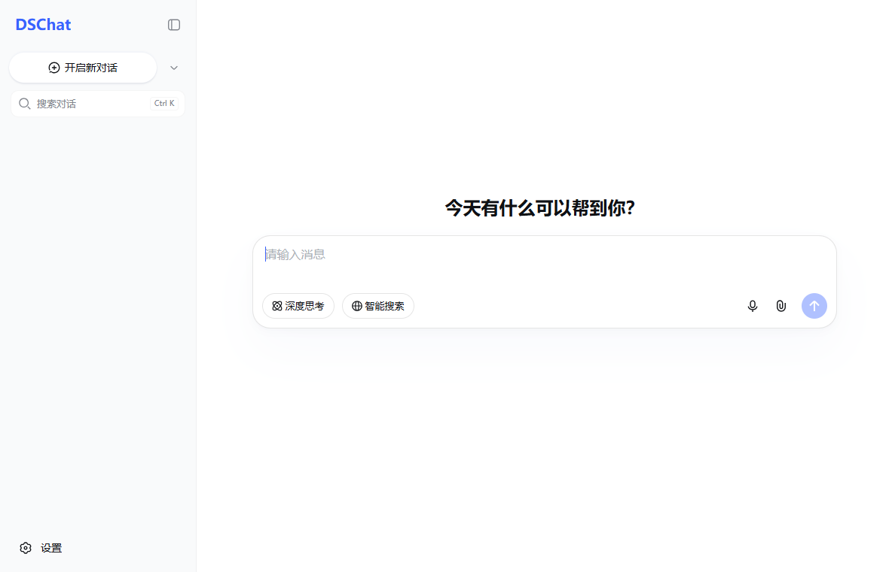
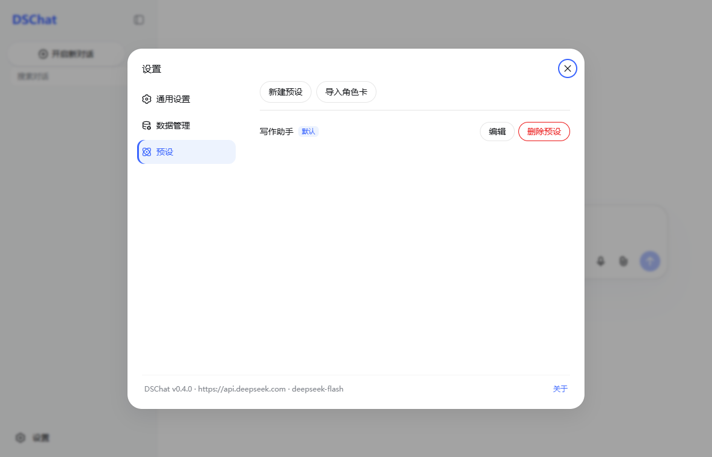
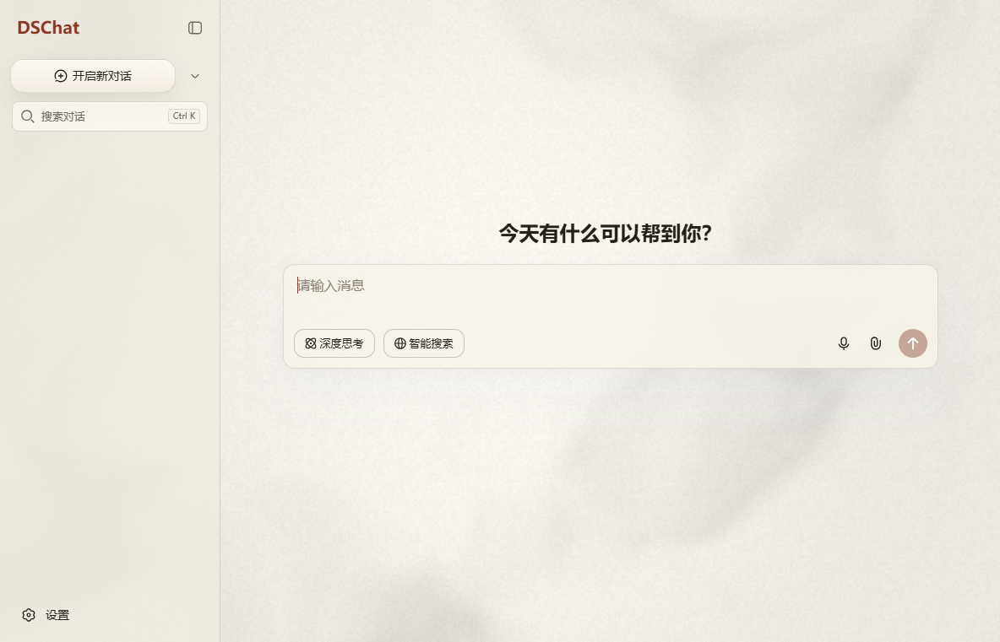
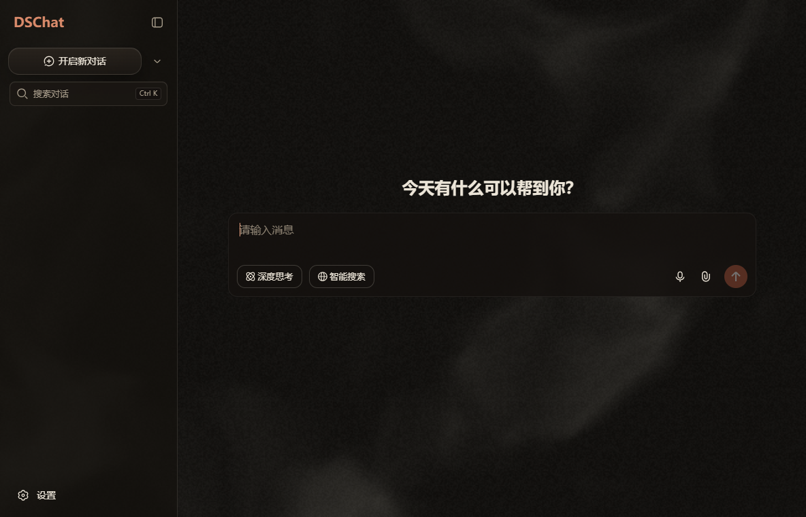
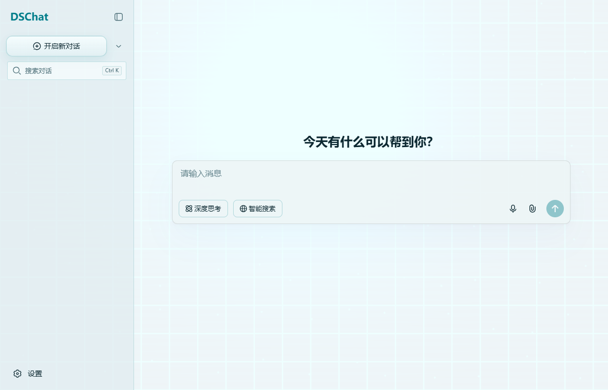
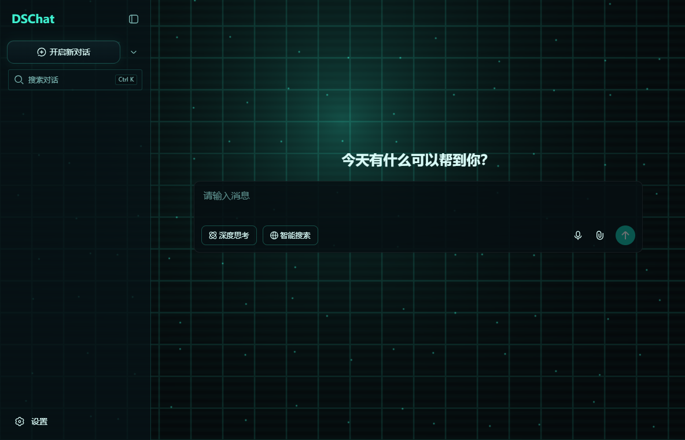

<div align="center">

# DSChat

**A desktop and web chat client for the DeepSeek API. Your key, your data.**

[Download for Windows](https://github.com/dashaeraavretu/DSChat/releases/latest) · [Self-hosting](#self-hosting) · [Appearance](#appearance) · [Features](#features) · [FAQ](#faq)

[](https://github.com/dashaeraavretu/DSChat/releases/latest)
[](LICENSE)



</div>

DSChat is an open-source, local-first DeepSeek client. The desktop build wraps the official `chat-demo` interface in Electron; the web build is a static site you can host on Cloudflare Pages or any static host. It keeps the original interface and adds prompt presets, character-card import, quote replies, image export, temporary chats, and other everyday features.

**No account, no backend, no telemetry.** Every user brings their own DeepSeek API key; conversations and attachments stay on their device.

## Self-hosting

- **Web build (Cloudflare Pages recommended):** download `DSChat-x.y.z-web.zip` from a release and upload it, or connect the repository to Cloudflare Pages and build with `pnpm build` / output `dist`. Full instructions: **[docs/WEB-DEPLOY.md](docs/WEB-DEPLOY.md)**.
- **Desktop build / custom API:** build the installer, change the API origin, and review proxy/security notes in **[docs/SELF-HOST.md](docs/SELF-HOST.md)**.

You can also skip self-hosting and use the Windows installer from Releases.

## Download and install

1. Open [Releases](https://github.com/dashaeraavretu/DSChat/releases/latest).
2. Download `DSChat-x.y.z-x64.exe`.
3. Run the installer, then enter your own API key in Settings.

The installer is **not code-signed**, so Windows may show an "Unknown publisher" SmartScreen warning. Verify the file against `SHA256SUMS.txt` from the same release:

```powershell
Get-FileHash .\DSChat-x.y.z-x64.exe -Algorithm SHA256
```

Create an API key at the [DeepSeek platform](https://platform.deepseek.com/). Usage is billed to your own account.

Releases also include `DSChat-x.y.z-web.zip`: unzip it and upload the contents to Cloudflare Pages or any static host to run the web build without building from source.

## Deploy the web build (Cloudflare Pages)

The web build is static; no server is required. The easiest route is Cloudflare Pages with Git integration:

1. Fork this repository.
2. In the Cloudflare Dashboard, open **Workers & Pages** → **Create** → **Pages** → **Connect to Git** and select your fork.
3. Build command: `pnpm build`; output directory: `dist`; Node 24; pnpm `12.6.0`.
4. Save and deploy.

Or build locally and upload with Wrangler:

```sh
pnpm install
pnpm build
pnpm dlx wrangler pages deploy dist --project-name dschat
```

For a self-hosted gateway, set the API origin at build time:

```sh
DSCHAT_API_ORIGIN=https://api.example.com pnpm build
```

See **[docs/WEB-DEPLOY.md](docs/WEB-DEPLOY.md)** for custom domains, CORS, security headers, and PWA details.

> The web build can only keep the API key in browser `localStorage` as plaintext. Use it only on a trusted device; on a shared computer, enable "this session only" in Settings → Data.

## Features

### Chat

- Multiple conversations, automatic titles, rename/delete, search, pinning, and temporary chats.
- Streaming replies, deep thinking, stop/continue, edit prompts, regenerate, and message branches.
- Smart search, link reading, and source citations (provided by the DeepSeek API).
- Per-reply timestamp, token usage, and elapsed time.

### Input and attachments

- Text, image, PDF, and Office attachments; drag, paste, and pre-upload size/type checks.
- Voice input and read-aloud with adjustable speed.
- Quote selected text, per-session input history (↑/↓), and an optional character counter.
- Enter / Ctrl+Enter send preference; `Ctrl+K` search, `Ctrl+N` new chat, `Ctrl+,` settings, `Esc` close/stop.

### Prompts and characters

- A Presets section in Settings: create, edit, mark a default, inject a system prompt every turn, and show a greeting on empty chats.
- Import Tavern V2/V3 character cards (`.json` / `.png`) as presets.
- Preset variables: `{{user}}`, `{{char}}`, `{{date}}`, `{{time}}`, `{{original}}`.
- Each conversation snapshots its preset, so later edits do not change existing chats.



### Reading and export

- Markdown, syntax highlighting, KaTeX math, and Mermaid diagrams.
- Hover-to-copy display math; comfortable/wide reading width.
- Export a single conversation as Markdown, a conversation as an image, or all history as ZIP.
- Optional appearance presets (original / TUI / fat fish / paper / ink / geek), light/dark/system themes, Chinese and English UI.

### Desktop and web

- Desktop: window-position memory, tray, close-to-tray, completion notifications, zoom, HTTP/SOCKS5 proxy, and diagnostics export.
- About → Check for updates: queries GitHub Releases and opens the download page; it never installs automatically.
- Web: installable PWA with an offline app shell; deployable to Cloudflare Pages.

## Appearance

Settings → General → Appearance switches between six token-only themes without changing the message layout:

- **Original**, **TUI**, **Fat fish**, **Paper**, **Ink** (paper, ink wash, vermilion; WebGL background), **Geek** (cool grid, particles, scanlines; WebGL background).
- Ink and Geek respect `prefers-reduced-motion` and can be made static in Settings.
- Implementation notes and references: **[docs/APPEARANCE.md](docs/APPEARANCE.md)**.

| Ink (light) | Ink (dark) |
| --- | --- |
|  |  |

| Geek (light) | Geek (dark) |
| --- | --- |
|  |  |

## Privacy and data

- **Desktop API key:** held only by the main process and encrypted with Windows DPAPI (`safeStorage`). If system encryption is unavailable, the key stays in memory for that run only. There is no plaintext file and no `localStorage` fallback.
- **Web API key:** stored in browser `localStorage` as plaintext. Use the "this session only" option to avoid persisting it.
- **Conversations and attachments:** stored locally in IndexedDB / local files. No cloud account and no upload to a server controlled by this project.
- **Network:** messages, attachments, and speech are sent only to the API service you configure. There is no telemetry or crash reporting.
- **Exports:** history ZIP files exclude the API key; diagnostics redact keys and sensitive headers.

## FAQ

### Which API key should I use?

The default release connects only to the official `https://api.deepseek.com`. Create a key on the [DeepSeek platform](https://platform.deepseek.com/). Compatible gateways are supported only in internal test builds, not the default release.

### Why does Windows show "Unknown publisher"?

The installer is unsigned because no code-signing certificate is purchased. Verify the SHA256 from the release page, or build from source yourself.

### Does "Check for updates" install automatically?

No. It only queries the public GitHub Releases API and opens the download page in your browser. You install manually.

### Can the web build work offline?

After the first load, the PWA caches the app shell and static assets. You can open the UI and read local conversations offline, but sending messages still needs the network and the API service.

### Does a self-hosted gateway need CORS?

The web build calls the API from the browser, so the gateway must allow your site origin. The desktop build sends requests from the main process and does not need CORS. See [docs/WEB-DEPLOY.md](docs/WEB-DEPLOY.md) and [docs/SELF-HOST.md](docs/SELF-HOST.md).

### Does update checking support private repositories?

No. It uses the public GitHub Releases API without a token; private repositories would need extra authentication, which is not implemented.

## Development

Requirements: Node.js 22.12+ and pnpm.

| Command | Description |
| --- | --- |
| `pnpm dev` | Start the web dev server on port 8090 |
| `pnpm dev:desktop` | Electron with the dev server |
| `pnpm build` | Build the static web app into `dist/` |
| `pnpm dist:win` | Build the Windows installer |
| `pnpm dist:test` | Build the Qianji test installer (not distributed) |
| `pnpm type` / `pnpm lint` | Type check / lint |
| `pnpm test` | Headless regression tests |
| `pnpm test:proxy` | Main-process API proxy smoke test |
| `pnpm test:update` | Update-check smoke test |

## Documentation

- **[Web deployment and Cloudflare Pages](docs/WEB-DEPLOY.md)**
- **[Self-hosting, custom API origins, and security](docs/SELF-HOST.md)**
- **[Appearance system and WebGL backgrounds](docs/APPEARANCE.md)**
- [Feature parity checklist](docs/FEATURE-PARITY.md)
- [Manual QA checklist](docs/QA-CHECKLIST.md)
- [Changelog](CHANGELOG.md)

## License and attribution

DSChat is derived from [deepseek-ai/chat-demo](https://github.com/deepseek-ai/chat-demo), Copyright (c) 2026 DeepSeek, licensed under the [MIT License](LICENSE). Upstream attribution and license notices are retained; builds copy the license to `dist/LICENSE`.

Third-party dependencies keep their own licenses; see [THIRD_PARTY_NOTICES.md](THIRD_PARTY_NOTICES.md). DSChat is an independent community project, not an official DeepSeek product. Do not use DeepSeek names or marks in a way that implies official endorsement.
