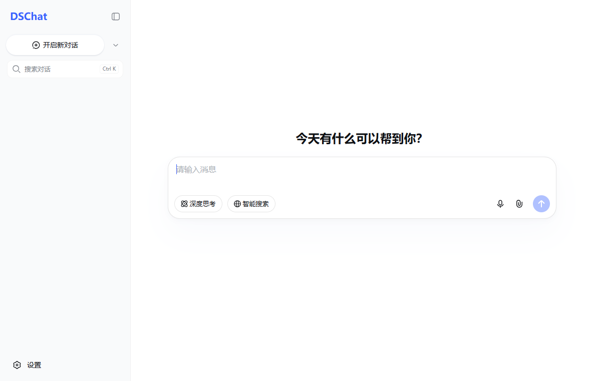
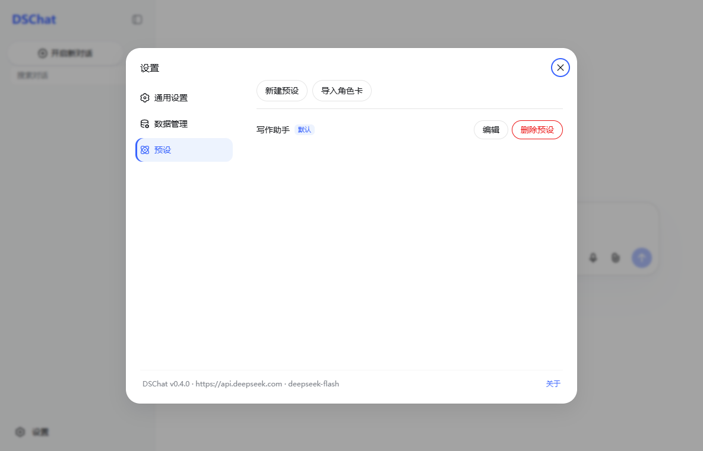
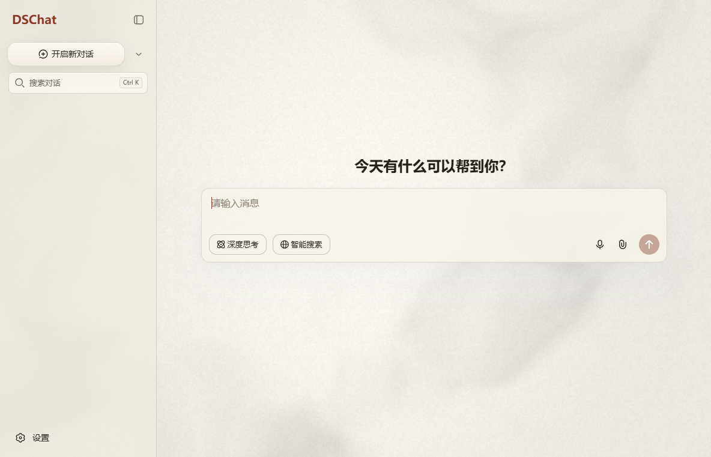
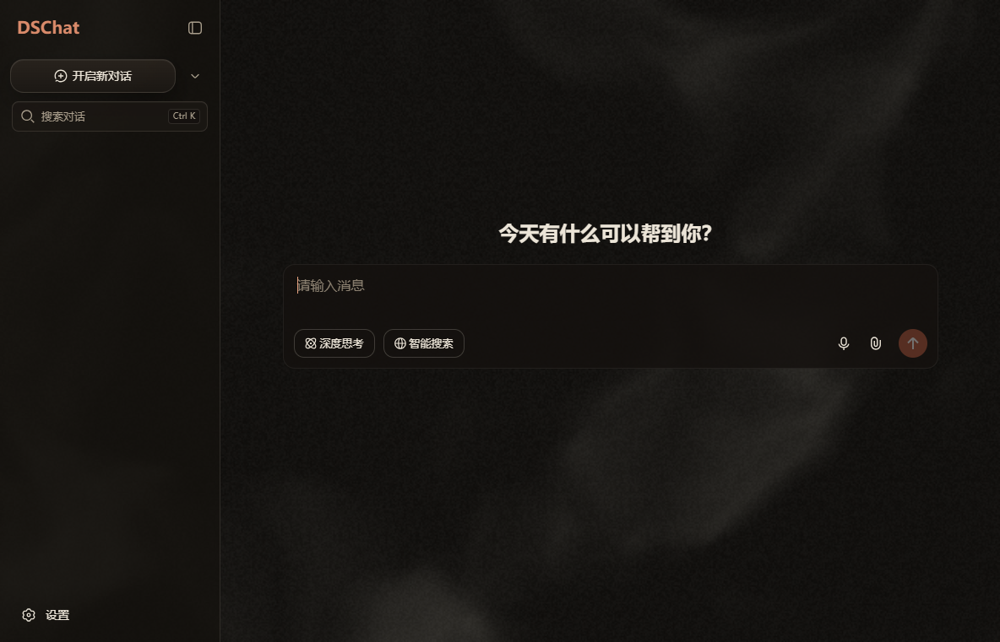
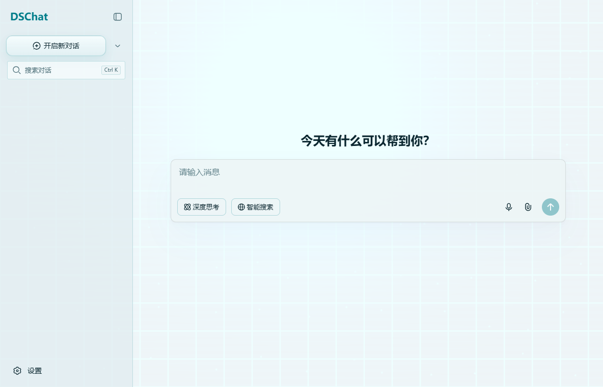
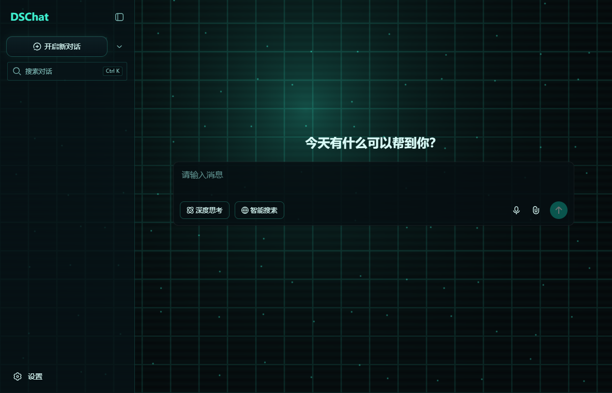

<div align="center">

# DSChat

**面向 DeepSeek API 的桌面与 Web 聊天客户端。自己的 Key，自己的数据。**

[下载 Windows 版](https://github.com/dashaeraavretu/DSChat/releases/latest) · [自部署](#自部署) · [外观](#外观) · [功能](#功能) · [常见问题](#常见问题) · [English](README.en.md)

[](https://github.com/dashaeraavretu/DSChat/releases/latest)
[](LICENSE)



</div>

DSChat 是一个开源、本地优先的 DeepSeek 客户端。桌面版用 Electron 封装为 Windows 应用；Web 版是纯静态站点，可以自己部署到 Cloudflare Pages 等平台。界面沿用 DeepSeek 官方 `chat-demo`，并补上了日常使用需要的提示词预设、角色卡导入、引用回复、导出图片、临时会话等功能。

**不需要账号，没有官方后端，没有遥测。** 每位使用者填写自己的 DeepSeek API Key，会话和附件保存在本机。

## 自部署

DSChat 提供 Web 版与桌面版两种自部署方式，文档都在仓库里：

- **Web 版（推荐 Cloudflare Pages）**：纯静态站点。下载 Release 的 `DSChat-x.y.z-web.zip` 解压上传，或让 Cloudflare 直接连 Git 构建。
  完整步骤（Cloudflare Pages、Wrangler、GitHub Actions、自定义域名、CSP、CORS、PWA）见 **[docs/WEB-DEPLOY.md](docs/WEB-DEPLOY.md)**。
- **桌面版自构建 / 自定义 API**：构建安装包、修改 API 地址、代理与安全说明见 **[docs/SELF-HOST.md](docs/SELF-HOST.md)**。

不想自己部署，也可以直接下载 Releases 里的 Windows 安装包。

## 下载与安装

1. 打开 [Releases](https://github.com/dashaeraavretu/DSChat/releases/latest)。
2. 下载 `DSChat-x.y.z-x64.exe`。
3. 运行安装包，启动后在设置里填入自己的 API Key。

安装包目前**未做代码签名**，Windows 可能提示“未知发布者”；这是预期行为。请从 Releases 页面下载，并用同页的 `SHA256SUMS.txt` 核对文件：

```powershell
Get-FileHash .\DSChat-x.y.z-x64.exe -Algorithm SHA256
```

API Key 可在 [DeepSeek 开放平台](https://platform.deepseek.com/) 创建，用量计入你自己的账户。

Releases 同时提供 `DSChat-x.y.z-web.zip`：解压后把内容上传到 Cloudflare Pages 或任意静态托管即可使用 Web 版，无需自己构建。

## Web 版部署（Cloudflare Pages）

Web 版是纯静态资源，不需要服务器。最省事的方式是让 Cloudflare 直接从 Git 构建：

1. Fork 本仓库。
2. 打开 Cloudflare Dashboard → **Workers & Pages** → **Create** → **Pages** → **Connect to Git**，选择你的仓库。
3. 构建命令填 `pnpm build`，输出目录填 `dist`；Node 版本选 24，pnpm 版本填 `12.6.0`。
4. 保存并部署。

也可以本地构建后用 Wrangler 上传：

```sh
pnpm install
pnpm build
pnpm dlx wrangler pages deploy dist --project-name dschat
```

使用自建网关时，在构建阶段设置 API 地址：

```sh
DSCHAT_API_ORIGIN=https://api.example.com pnpm build
```

详细步骤、自定义域名、CORS、安全响应头与 PWA 说明见 **[docs/WEB-DEPLOY.md](docs/WEB-DEPLOY.md)**。

> 网页版只能把 API Key 保存在浏览器 `localStorage`，是明文本地存储。请只在可信设备和浏览器配置中使用；公共电脑建议用「仅本次会话」模式（设置 → 数据管理）。

## 功能

| 分类 | 能力 |
| --- | --- |
| 对话 | 多会话、自动标题、搜索、置顶、临时会话、编辑提问、重新生成、消息分支 |
| 生成 | 流式回答、深度思考、智能搜索、链接阅读、来源引用、停止/继续、错误重试 |
| 输入 | 文本/图片/PDF/Office 附件、拖拽/粘贴、上传预检、语音输入、朗读、引用回复、输入历史、字数统计 |
| 提示词 | 预设、酒馆角色卡 V2/V3、变量、开场白、每轮注入、会话快照、预设导出/导入 |
| 阅读 | Markdown、代码高亮、KaTeX、Mermaid、公式复制、舒适/宽阅读宽度 |
| 导出 | 单会话 Markdown、会话/消息图片、全量历史 ZIP、诊断日志 |
| 桌面 | 窗口记忆、托盘、关闭到托盘、缩放、HTTP/SOCKS5 代理、完成通知、更新检查 |
| Web | PWA 安装、离线外壳、Cloudflare Pages、会话级 API Key、安全响应头 |
| 外观 | 原版 / TUI / 胖鱼 / 纸张 / 水墨 / 极客，浅色/深色/跟随系统，中英文 |

### 对话

- 多会话、自动标题、重命名、删除；会话搜索、置顶、临时会话。
- 流式回答、深度思考、停止生成、继续生成；编辑提问、重新生成、消息分支切换。
- 智能搜索、链接阅读、来源引用（由 DeepSeek API 提供）。
- 每条回复显示时间、Token 用量与耗时。

### 输入与附件

- 文本、图片、PDF、Office 附件；拖拽、粘贴、上传前数量/大小/类型预检。
- 语音输入与回复朗读；朗读语速可调。
- 引用选中文本回复；会话级输入历史（↑/↓）；可选字数统计。
- Enter / Ctrl+Enter 发送偏好；`Ctrl+K` 搜索、`Ctrl+N` 新建、`Ctrl+,` 设置、`Esc` 关闭/停止。

### 提示词与角色

- 设置内置「预设」：新建、编辑、默认标记；每轮注入 system 提示，空会话显示开场白。
- 导入酒馆角色卡 V2/V3（`.json` / `.png`）为预设。
- 预设变量：`{{user}}`、`{{char}}`、`{{date}}`、`{{time}}`、`{{original}}`。
- 会话创建时固化预设快照，之后修改预设不会影响已有会话。



### 阅读与导出

- Markdown、代码高亮、KaTeX 公式、Mermaid 图表。
- 行间公式悬停复制；舒适/宽阅读宽度。
- 单会话导出 Markdown；会话/消息导出为图片；全量历史 ZIP 导入导出。
- 六套可选外观（原版 / TUI / 胖鱼 / 纸张 / 水墨 / 极客），浅色、深色、跟随系统；中英文界面。

### 桌面与 Web

- 桌面版：窗口位置记忆、托盘、关闭到托盘、完成通知、界面缩放、HTTP/SOCKS5 代理、诊断日志导出。
- 关于页「检查更新」：查询 GitHub Releases，有更新时打开下载页，不自动安装。
- Web 版：可安装为 PWA，支持应用外壳离线缓存；可部署到 Cloudflare Pages。

## 外观

设置 → 通用 → 外观 可切换六套风格，全部只覆盖 token，不改消息区布局：

- **原版**：官方 `chat-demo` 外观。
- **TUI**：Gruvbox 暖色、方角、终端感。
- **胖鱼**：青绿 + 珊瑚、大圆角、原创吉祥物。
- **纸张**：暖白、低饱和、衬线标题。
- **水墨**：宣纸、墨晕、朱砂强调；WebGL 动态背景。
- **极客**：冷色网格、粒子、扫描线；WebGL 动态背景。

水墨和极客背景会遵循系统的「减少动态效果」，也可以在设置里关闭动态背景。实现方式与参考的博客/WebGL 技术见 [docs/APPEARANCE.md](docs/APPEARANCE.md)。

| 水墨（浅色） | 水墨（深色） |
| --- | --- |
|  |  |

| 极客（浅色） | 极客（深色） |
| --- | --- |
|  |  |

## 隐私与数据

- **桌面版 API Key**：只由主进程持有，经 Windows DPAPI（Electron `safeStorage`）加密后保存；系统加密不可用时只保留在本次运行的内存中，重启需重新输入。不会写明文文件，也不会回退到 `localStorage`。
- **Web 版 API Key**：保存在浏览器 `localStorage`（明文）。可用「仅本次会话」模式避免落盘。
- **会话与附件**：保存在本机 IndexedDB / 本地文件；没有云端账号，也不会自动上传到本项目控制的服务器。
- **网络**：消息、附件与语音只发送到你配置的 API 服务。网页版和桌面版都不包含遥测或崩溃上报。
- **导出**：历史 ZIP 不包含 API Key；诊断日志会脱敏 Key 与敏感请求头。

## 常见问题

### 应该用哪个 API Key？

默认发布只连接官方 `https://api.deepseek.com`，在 [DeepSeek 开放平台](https://platform.deepseek.com/) 创建 Key 即可。千机等兼容网关只用于内部测试构建，不进入默认发布。

### Windows 提示“未知发布者”怎么办？

当前没有购买代码签名证书，安装包未签名。请核对 Releases 页面的 SHA256；如果你不能接受 SmartScreen 警告，可以自行从源码构建。

### 「检查更新」会自动升级吗？

不会。它只查询公开 GitHub Releases，有更新时在系统浏览器打开下载页。安装仍由你手动完成。

### Web 版能离线用吗？

首次加载后，PWA 会缓存应用外壳和静态资源；离线时可以打开界面和查看本地会话，但发送消息仍需要网络和 API 服务。

### 自建网关需要配置 CORS 吗？

Web 版从浏览器直接请求 API，服务端需要允许你的站点源。桌面版所有请求由主进程代理发出，不需要 CORS。细节见 [docs/WEB-DEPLOY.md](docs/WEB-DEPLOY.md) 和 [docs/SELF-HOST.md](docs/SELF-HOST.md)。

### 更新检查支持私有仓库吗？

不支持。更新检查使用公开的 GitHub Releases API，不需要 Token；私有仓库需要额外鉴权，当前未实现。

## 开发

环境：Node.js 22.12+、pnpm。

| 命令 | 说明 |
| --- | --- |
| `pnpm dev` | 启动网页开发服务器（8090） |
| `pnpm dev:desktop` | Electron + 开发服务器 |
| `pnpm build` | 构建 Web 静态产物到 `dist/` |
| `pnpm dist:win` | 构建 Windows 安装包 |
| `pnpm dist:web` | 构建 Web 静态产物并打包为 `DSChat-x.y.z-web.zip` |
| `pnpm dist:test` | 构建千机测试包（不对外分发） |
| `pnpm deploy:cf` | 构建并部署到 Cloudflare Pages |
| `pnpm type` / `pnpm lint` | 类型检查 / Lint |
| `pnpm test` | 无头回归测试 |
| `pnpm test:proxy` | 主进程 API 代理冒烟 |
| `pnpm test:update` | 更新检查冒烟 |

## 文档

- **[Web 部署与 Cloudflare Pages](docs/WEB-DEPLOY.md)**：Git 集成、Wrangler、GitHub Actions、自定义域名、CSP/CORS、PWA。
- **[自部署、自定义 API 与安全说明](docs/SELF-HOST.md)**：桌面版构建、API 地址、Key 存储、代理与分发。
- **[外观系统与 WebGL 背景](docs/APPEARANCE.md)**：六套外观、水墨/极客 shader、参考的博客与最佳实践。
- [功能对齐清单](docs/FEATURE-PARITY.md)
- [手动验收清单](docs/QA-CHECKLIST.md)
- [更新日志](CHANGELOG.md)

## 许可证与致谢

DSChat 派生自 [deepseek-ai/chat-demo](https://github.com/deepseek-ai/chat-demo)，Copyright (c) 2026 DeepSeek，遵循 [MIT 许可证](LICENSE)。上游署名与许可证声明均已保留；构建会把许可证复制到 `dist/LICENSE`。

第三方依赖遵循各自许可证，详见 [THIRD_PARTY_NOTICES.md](THIRD_PARTY_NOTICES.md)。DSChat 是独立的社区项目，并非 DeepSeek 官方产品；请勿以暗示官方背书的方式使用 DeepSeek 名称或标识。
